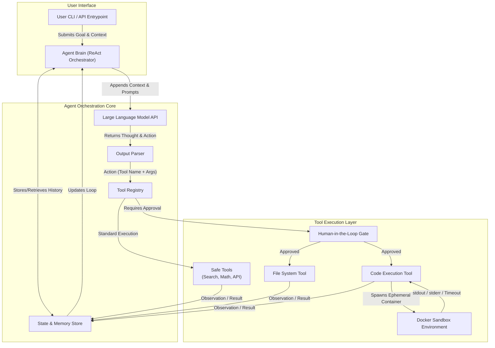

# System Architecture & Design Specification

## Overview

The **Autonomous AI Agent System** is a production-grade, secure agent framework developed in Python. It pairs Large Language Model (LLM) reasoning with an extensible Tool Execution Layer isolated within ephemeral Docker containers.

The architecture implements:
1. **The ReAct Loop**: Interleaved reasoning (*Thought*), environment action (*Action*), and observation capture (*Observation*).
2. **Deterministic Schema Enforcement**: Dynamic injection of Pydantic-validated JSON schemas into model prompts.
3. **Multi-Layered Security Sandboxing**: Ephemeral Docker containers with zero network access, memory quotas, strict timeouts, and workspace path traversal prevention.
4. **Human-in-the-Loop (HITL) Safety Gates**: Halts execution before invoking high-risk operations (arbitrary code execution or file system writes) until explicit user authorization is provided.
5. **Programmatic Observability**: Step-by-step trace serialization into `execution_trace.jsonl` along with structured terminal logging.

---

## Architecture Diagram



---

## Component Deep Dive

### 1. Agent Orchestration Core (`src/agent/`)
- **`ReActAgent` (`src/agent/react.py`)**: Central control loop. Coordinates prompting the LLM, passing messages through memory, evaluating approval constraints, delegating to the `ToolRegistry`, and enforcing loop termination (default limit: 15 iterations).
- **`OutputParser` (`src/agent/parser.py`)**: Parses model output into a strongly typed `AgentStep`. Supports raw JSON, markdown-fenced code blocks (` ```json `), and regex extraction of embedded dictionaries. Extracts `thought`, `action`/`tool_name`, and `action_input`/`tool_arguments`.
- **`LLMClient` (`src/agent/llm_client.py`)**: Intermediary client providing seamless switching between OpenAI API calls and an offline `DeterministicReActEngine` for deterministic testing and automated grading.

### 2. State & Memory Store (`src/memory/memory.py`)
- **Conversation State**: Maintains ordered `Message` objects with roles (`system`, `user`, `assistant`, `observation`).
- **Sliding Window Pruning**: Prevents context window exhaustion. Automatically pins the system prompt (index 0) and original user goal (index 1), sliding older intermediate thoughts and tool results when message limits are reached.
- **Payload Truncation**: Enforces length caps on raw observations before ingestion.

### 3. Tool Registry & Interfaces (`src/tools/`)
- **`BaseTool` (`src/tools/base.py`)**: Abstract base contract mandating:
  - `name`: Unique identifier.
  - `description`: Prompt-engineered semantic description informing LLM tool selection.
  - `args_schema`: Pydantic `BaseModel` defining exact parameter types and required fields.
  - `requires_approval`: Boolean flag marking high-risk actions.
  - `validate_args()`: Enforces runtime validation before execution.
- **`ToolRegistry` (`src/tools/registry.py`)**: Dynamic catalog aggregating available tools and generating serialized JSON Schemas injected into the system prompt.

---

## Security & Sandboxing Architecture

### Multi-Tier Defense Strategy

```
+-------------------------------------------------------------------+
|                        Host Operating System                      |
|                                                                   |
|   +-----------------------------------------------------------+   |
|   |                  Human-in-the-Loop Gate                   |   |
|   |         (Interactive approval for high-risk actions)      |   |
|   +-----------------------------------------------------------+   |
|                                 |                                 |
|                                 v                                 |
|   +-----------------------------------------------------------+   |
|   |                File System Path Traversal Guard           |   |
|   |     (os.path.commonpath enforces strict WORKSPACE_DIR)    |   |
|   +-----------------------------------------------------------+   |
|                                 |                                 |
|                                 v                                 |
|   +-----------------------------------------------------------+   |
|   |               Docker Kernel-Level Isolation               |   |
|   |  - network_disabled=True (Zero outbound network access)   |   |
|   |  - mem_limit=128m (Prevents memory exhaustion attacks)    |   |
|   |  - Read-Only volume mounts (/sandbox:ro)                  |   |
|   |  - 15s Watchdog Timer (Forceful container.kill())         |   |
|   |  - Guaranteed Ephemeral Cleanup (container.remove())      |   |
|   +-----------------------------------------------------------+   |
+-------------------------------------------------------------------+
```

### 1. Docker Sandbox Isolation (`src/sandbox/docker_runner.py`)
Arbitrary Python code supplied by the LLM is never executed on the host runtime:
- **Detached Execution**: Containers spawn via `client.containers.run(..., detach=True)`.
- **Zero Network Egress**: `network_disabled=True` blocks network sockets, eliminating data exfiltration and reverse shells.
- **Memory Capping**: `mem_limit='128m'` prevents resource exhaustion attacks (e.g., memory bombs).
- **Ephemeral Script Mount**: Host writes code to an isolated temp directory mounted as read-only (`:ro`) at `/sandbox`.
- **Timeout Watchdog**: Monitored via timeout detection. If container runtime exceeds 15 seconds, a forceful `container.kill()` is issued, returning `"Execution timed out"` to agent memory.
- **Guaranteed Cleanup**: Containers are purged via `container.remove(force=True)` in a `finally` block.

### 2. File System Path Traversal Defense (`src/tools/filesystem.py`)
- All file targets are resolved against `WORKSPACE_DIR` using `os.path.realpath(os.path.abspath(...))`.
- Evaluates `os.path.commonpath([WORKSPACE_DIR, target_path]) == WORKSPACE_DIR`.
- Attempts to escape (e.g. `../../etc/passwd`, `..\..\..\Windows`) are blocked, immediately returning a `Security Violation` observation without executing file I/O.

### 3. Safe Math Evaluator (`src/tools/calculator.py`)
- Strictly prohibits raw `eval()`.
- Uses Python's `ast` (Abstract Syntax Tree) module to walk expressions.
- Permissive only for numbers, basic arithmetic operators (`+`, `-`, `*`, `/`, `**`, `//`, `%`), and whitelisted safe mathematical functions (`sqrt`, `abs`, `round`, `sin`, `cos`, etc.).
- Rejects system calls, object attributes, and arbitrary function invocations.

---

## Observability & Trace Contract

Execution traces are written in JSON Lines format to `execution_trace.jsonl` in the repository root.

### Trace Entry Schema:
```json
{
  "timestamp": "2026-10-16T16:51:37.504320+00:00",
  "iteration": 1,
  "thought": "I need to compute the mathematical expression accurately using the calculator tool without raw eval.",
  "action_selected": "calculator",
  "action_arguments": {
    "expression": "42 * 10"
  },
  "observation": "420"
}
```
