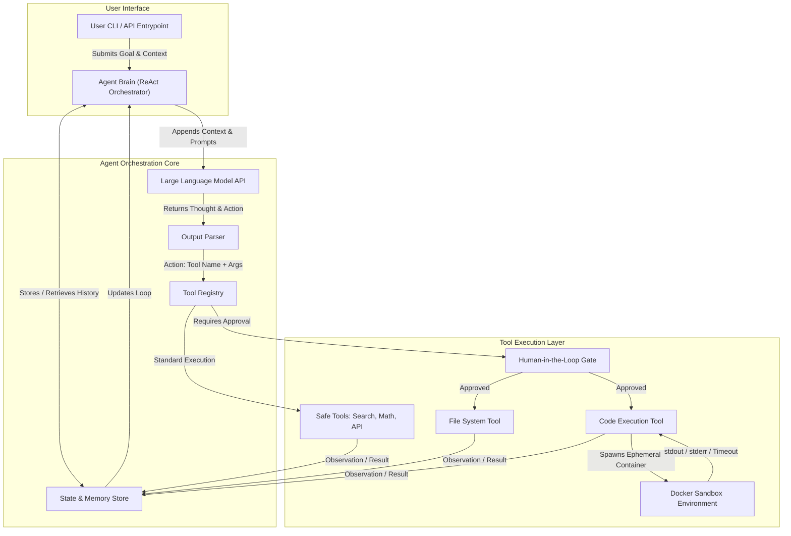

# Autonomous AI Agent System with Advanced Tool Integration

<p align="center">
  <strong>A Python-based autonomous AI agent integrating intelligent reasoning, advanced tools, human approval, and Docker-based code execution.</strong>
</p>

<p align="center">
  
  
  
  
</p>

## 1. Overview

The **Autonomous AI Agent System with Advanced Tool Integration** is a Python-based application designed to execute user-defined tasks through intelligent reasoning, tool selection, and iterative feedback.

Unlike a conventional chatbot that primarily generates text, this system follows a **Reasoning → Action → Observation** workflow. It interprets a user's goal, selects an appropriate tool, executes the action, evaluates the result, and continues until it produces a final answer or reaches its configured iteration limit.

The system integrates web search, mathematical calculations, REST API interactions, workspace file operations, and Python code execution. A Human-in-the-Loop (HITL) approval mechanism provides oversight for sensitive operations, while Docker provides an isolated environment for code execution.

The project also supports a deterministic mock LLM mode for testing and evaluation without requiring a live language model API.

## 2. Objectives

- Develop a modular AI agent capable of handling multi-step tasks.
- Implement a ReAct-based reasoning and tool-execution workflow.
- Integrate multiple tools through a unified tool registry.
- Execute Python code using Docker-based sandboxing.
- Introduce human approval for sensitive operations.
- Maintain execution state and memory across agent iterations.
- Record execution traces for debugging and analysis.
- Support automated testing and benchmark evaluation.
- Improve execution reliability through input validation and error handling.

## 3. Key Features

- **ReAct Reasoning Loop:** Coordinates reasoning, action selection, tool execution, and observation.
- **Advanced Tool Integration:** Provides five tools for search, calculations, API requests, file operations, and code execution.
- **LLM-Powered Decision-Making:** Uses a language model API to interpret tasks and generate structured actions.
- **Structured Output Parsing:** Extracts tool names, arguments, and final answers from model responses.
- **Human-in-the-Loop Approval:** Routes sensitive operations through an approval gate before execution.
- **Docker-Based Code Execution:** Runs Python code in a separate container with configurable resource limits.
- **Workspace File Protection:** Restricts file operations to the configured workspace.
- **Safe Calculator:** Evaluates supported mathematical expressions using Python's Abstract Syntax Tree (AST).
- **State and Memory Management:** Stores and retrieves relevant execution history and observations.
- **Execution Trace Logging:** Records agent execution steps in JSON Lines format.
- **Offline Mock Mode:** Supports deterministic testing without live LLM calls.
- **Configurable LLM Integration:** Supports model selection and an OpenAI-compatible API endpoint.
- **Automated Testing:** Provides tests for the agent, parser, tools, memory, sandbox, and approval workflow.
- **Docker Compose Support:** Simplifies containerized execution and integration testing.

## 4. System Architecture

The system follows a modular architecture consisting of three major layers: the **User Interface**, **Agent Orchestration Core**, and **Tool Execution Layer**.

These components work together to process user goals, coordinate LLM-based reasoning, execute tool calls, manage approval requirements, and return observations to the agent for subsequent iterations.



### Architecture Components

**1. User Interface**

The User CLI / API Entry Point accepts the user's goal and relevant context and submits them to the Agent Brain for processing.

**2. Agent Brain (ReAct Orchestrator)**

The Agent Brain coordinates the ReAct reasoning loop. It prepares the task context, communicates with the LLM API, processes observations, and determines whether another action is required or the final answer can be returned.

**3. Large Language Model API**

The LLM API receives the task context, conversation history, and tool instructions. It generates a structured response containing the next action or a final answer.

**4. Output Parser**

The Output Parser interprets the model response and extracts the action type, tool name, and arguments. The parsed action is passed to the Tool Registry for execution.

**5. Tool Registry**

The Tool Registry identifies the requested tool and dispatches the action to the appropriate execution component. It distinguishes standard tool execution from operations that require human approval.

**6. Human-in-the-Loop Gate**

The HITL Gate introduces human oversight before sensitive operations, particularly workspace file writes and Python code execution. Approved operations proceed to the corresponding tool, while rejected operations are handled according to the application's approval and error-handling logic.

**7. Safe Tools**

The Safe Tools component groups the tools used for web search, mathematical calculations, and REST API interactions. These tools execute supported operations and return their results to the agent's state and memory store.

**8. File System Tool**

The File System Tool performs permitted file operations within the configured workspace. Workspace restrictions help prevent unauthorized access to files outside the designated directory.

**9. Code Execution Tool**

The Code Execution Tool receives Python code and invokes the Docker Sandbox Environment. It collects the available execution results, including standard output, standard error, and timeout information.

**10. Docker Sandbox Environment**

The Docker Sandbox Environment executes Python code inside a separate, temporary container. This separation helps isolate code execution from the main agent process.

**11. State & Memory Store**

The State & Memory Store maintains and retrieves relevant conversation history, task context, and tool observations. The Agent Brain uses this information to continue the reasoning loop with the results of previous actions.

### How It Works

1. **Goal Submission:** The user submits a task through the CLI or API entry point.
2. **Context Preparation:** The Agent Brain prepares the task context, relevant history, and available tool instructions.
3. **LLM Interaction:** The agent sends the context and prompts to the Large Language Model API.
4. **Action Generation:** The LLM returns a proposed action or final answer.
5. **Response Parsing:** The Output Parser extracts the action, tool name, and arguments.
6. **Tool Routing:** The Tool Registry identifies the appropriate tool.
7. **Approval Check:** If the action requires authorization, the Human-in-the-Loop Gate requests approval.
8. **Tool Execution:** The selected tool executes the approved or standard operation. Python code execution uses the Docker sandbox.
9. **Observation Collection:** The tool returns its result, error information, or execution output.
10. **State Update:** The observation is stored in the State & Memory Store.
11. **Iterative Reasoning:** The Agent Brain retrieves the updated context and continues the ReAct loop.
12. **Final Response:** The agent returns the final answer when the task is complete or stops when the configured iteration limit is reached.

## 5. Tools and Their Functions

| Tool | Description |
|---|---|
| Web Search | Retrieves relevant information through web search services. |
| Safe Calculator | Evaluates supported mathematical expressions. |
| REST API Client | Makes supported HTTP requests to external or mock APIs. |
| Workspace File System | Performs permitted file operations within the configured workspace. |
| Python Code Execution | Executes Python code through the Docker-based sandbox. |

## 6. Technology Stack

| Category | Technology |
|---|---|
| Programming Language | Python |
| LLM Integration | OpenAI-compatible Chat Completions API |
| Agent Architecture | Custom ReAct reasoning loop |
| Input Validation | Pydantic |
| Web Search | DuckDuckGo Search, optional Tavily API |
| HTTP Communication | Requests |
| Code Execution | Docker |
| Configuration | Environment variables, python-dotenv |
| Logging | Python logging, JSONL execution traces |
| Testing | pytest |
| Container Orchestration | Docker Compose |

## 7. Project Structure

```text
Autonomous_AI-Agent_System_with_Advanced_Tool_Integration_using_Python_and_Docker/
│
├── src/
│   ├── agent/
│   │   ├── llm_client.py       # LLM client and mock engine
│   │   ├── parser.py           # Structured response parser
│   │   ├── prompt.py           # Agent prompt construction
│   │   └── react.py            # ReAct agent orchestration
│   │
│   ├── memory/
│   │   └── memory.py           # Agent memory
│   │
│   ├── sandbox/
│   │   └── docker_runner.py    # Docker-based code execution
│   │
│   ├── tools/
│   │   ├── api.py              # REST API integration
│   │   ├── base.py             # Base tool interface
│   │   ├── calculator.py       # Safe mathematical evaluation
│   │   ├── code_exec.py        # Python code execution tool
│   │   ├── filesystem.py       # Workspace file operations
│   │   ├── registry.py         # Tool registration and dispatch
│   │   └── search.py           # Web search integration
│   │
│   ├── __init__.py
│   ├── config.py               # Application configuration
│   ├── logger.py               # Logging and execution tracing
│   └── main.py                 # CLI entry point
│
├── evaluation/
│   ├── benchmarks.json         # Benchmark scenarios
│   └── run_benchmark.py        # Benchmark execution
│
├── tests/                      # Automated tests
├── workspace/                  # Agent-managed files
├── .env.example                # Example environment configuration
├── Dockerfile                  # Agent container configuration
├── docker-compose.yml           # Multi-container configuration
├── ARCHITECTURE.md              # Architecture documentation
├── testing.md                   # Testing instructions
├── requirements.txt             # Python dependencies
└── execution_trace.jsonl        # Runtime execution trace
```

## 8. Prerequisites

Before running the project, install:

- Python 3.10 or a version supported by the project dependencies.
- pip package manager.
- Docker Desktop or Docker Engine.
- Git.
- An OpenAI API key for live LLM mode.
- An optional Tavily API key for Tavily-backed web search.

## 9. Installation and Setup

### Step 1: Clone the Repository

```bash
git clone <YOUR_GITHUB_REPOSITORY_URL>
cd Autonomous_AI-Agent_System_with_Advanced_Tool_Integration_using_Python_and_Docker
```

Replace the placeholder with your actual GitHub repository URL.

### Step 2: Create a Virtual Environment

**Windows PowerShell**

```powershell
py -3.10 -m venv .venv
.\.venv\Scripts\Activate.ps1
```

**Linux / macOS**

```bash
python3 -m venv .venv
source .venv/bin/activate
```

### Step 3: Install Dependencies

```bash
python -m pip install --upgrade pip
pip install -r requirements.txt
```

### Step 4: Configure Environment Variables

**Windows PowerShell**

```powershell
Copy-Item .env.example .env
```

**Linux / macOS**

```bash
cp .env.example .env
```

Configure `.env` according to the environment variables supported by your application.

Example configuration:

```dotenv
OPENAI_API_KEY=your_openai_api_key_here
OPENAI_MODEL=gpt-4o-mini
OPENAI_API_BASE=https://api.openai.com/v1
TAVILY_API_KEY=
MAX_ITERATIONS=15
CONTAINER_TIMEOUT_SECONDS=15
CONTAINER_MEMORY_LIMIT=128m
SANDBOX_IMAGE=python:3.10-slim
WORKSPACE_DIR=./workspace
EXECUTION_TRACE_FILE=execution_trace.jsonl
LOG_LEVEL=INFO
MOCK_LLM=false
```

Verify the exact variable names and defaults in `src/config.py` and `.env.example`.

Never upload real API keys or passwords to GitHub.

### Step 5: Verify Docker

Ensure Docker Desktop or Docker Engine is running.

```bash
docker --version
docker info
```

### Step 6: Run an Offline Smoke Test

```bash
python src/main.py --goal "What is 42 multiplied by 10?" --mock-llm --auto-eval
```

This command is intended to verify a supported mock scenario without making live LLM calls.

### Step 7: Run with a Live LLM

After configuring a valid API key, execute:

```bash
python src/main.py --goal "Calculate 125 * 8 + sqrt(144) and explain the result."
```

The agent can select registered tools based on the configured model and task.

## 10. Example Use Cases

### Mathematical Calculations

```bash
python src/main.py --goal "What is 144 divided by 12?"
```

### Web Research

```bash
python src/main.py --goal "Find the official Python documentation and summarize its purpose."
```

### Workspace File Operations

```bash
python src/main.py --goal "Create a report.txt file in the workspace and read it back."
```

### REST API Integration

```bash
python src/main.py --goal "Query the mock API status endpoint and summarize the response."
```

### Python Code Execution

```bash
python src/main.py --goal "Write and execute Python code to calculate the 10th Fibonacci number."
```

Tool behavior depends on the configured model, registered tools, approval settings, network access, and sandbox availability.

## 11. Running with Docker Compose

Docker Compose provides a way to start the configured agent and mock API services.

### Start the Services

```bash
docker compose up --build
```

Review the terminal logs for service startup, API responses, and agent execution.

### Stop the Services

```bash
docker compose down
```

Check `docker-compose.yml` for the configured services, ports, environment variables, and startup commands.

## 12. Testing

Run the automated test suite:

```bash
pytest tests/ -v
```

Run a concise test summary:

```bash
pytest tests/ -q
```

Run the benchmark suite:

```bash
python -m evaluation.run_benchmark
```

For additional commands and verification steps, refer to [`testing.md`](testing.md).

### Testing Areas

- Agent reasoning and iteration handling.
- Structured response parsing.
- Tool registration and dispatch.
- Calculator expression validation.
- Workspace file restrictions.
- Docker execution and timeout handling.
- Human approval workflow.
- Memory and execution trace generation.
- Mock API integration.

## 13. Execution Trace and Debugging

The application can record execution steps in `execution_trace.jsonl`.

The trace helps developers inspect tool selection, action arguments, observations, iteration progress, and errors.

**Windows PowerShell**

```powershell
Get-Content .\execution_trace.jsonl -Tail 10
```

**Linux / macOS**

```bash
tail -n 10 execution_trace.jsonl
```

Review trace files before sharing them, as they may contain prompts, API responses, or workspace data.

## 14. Security Considerations

- **Human approval:** Keep approval checks enabled for sensitive operations during interactive use.
- **Docker isolation:** Configure resource limits and review container privileges, network access, and mounted volumes.
- **Workspace protection:** Validate file paths and restrict access to the permitted workspace.
- **API security:** Use trusted endpoints and avoid exposing credentials to untrusted services.
- **Input validation:** Validate model-generated tool arguments before execution.
- **Credential management:** Store secrets in environment variables or an appropriate secret manager.
- **Execution limits:** Configure timeouts, memory limits, and maximum reasoning iterations.
- **Logging hygiene:** Avoid recording sensitive information unnecessarily.

Docker is not a complete security guarantee. Access to the Docker daemon can provide extensive control over the host, so use Docker socket access only in a trusted development environment.

## 15. Learning Outcomes

This project demonstrates practical knowledge of:

- Python application development and modular architecture.
- Large Language Model (LLM) integration.
- ReAct-based reasoning and tool orchestration.
- Prompt engineering and structured response parsing.
- REST API and web search integration.
- Safe expression evaluation and input validation.
- Docker containerization and resource management.
- Human-in-the-loop approval mechanisms.
- State and memory management.
- Logging, debugging, automated testing, and benchmarking.


## 16. Author

**Kovvuri Harshitha**  
Computer Science and Engineering
